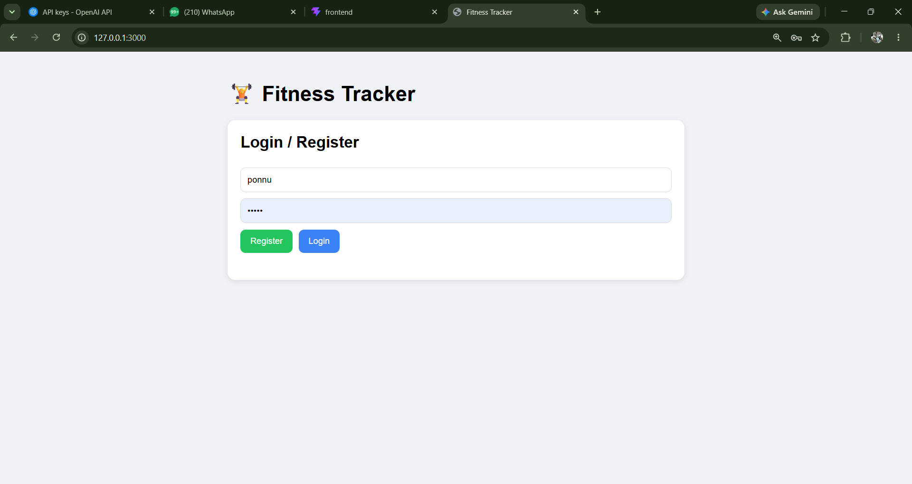

# Fitness & Meal Tracker

A small full-stack web app for tracking meals, workouts, calories, and protein by date. This document describes the current implementation and how to run it locally.

## Project Structure

```text
fitness tracker/
|-- backend/
|   |-- main.py          # FastAPI app, API routes, and SQLite models
|   |-- fitness.db       # Created automatically when the backend runs
|   `-- README.md        # This documentation
|-- frontend/
|   `-- index.html       # HTML, CSS, and browser-side JavaScript
`-- screenshots/         # UI screenshots referenced below
```

## Features

- Register an account and log in.
- Store passwords as hashes and use a bearer token for authenticated API requests.
- Add and delete meals, including calories and protein in grams.
- Add and delete workouts, including calories burned and duration in minutes.
- Filter entries by date.
- View daily calories eaten, calories burned, net calories, and protein totals.
- Keep meal and workout entries associated with the signed-in user.

## Technology

- Backend: Python, FastAPI, SQLAlchemy
- Database: SQLite
- Authentication: JWT bearer tokens and bcrypt password hashing
- Frontend: HTML, CSS, and JavaScript

## Run Locally

Use two terminals. Python must be installed. The frontend calls the API at `http://127.0.0.1:8001`, so keep the backend on port `8001`.

### 1. Install backend dependencies

In a terminal, move into the `backend` directory and install the packages used by the app:

```powershell
cd backend
python -m pip install fastapi uvicorn sqlalchemy "passlib[bcrypt]" "python-jose[cryptography]" python-multipart
```

### 2. Start the backend

From the `backend` directory:

```powershell
python -m uvicorn main:app --reload --port 8001
```

The API is available at `http://127.0.0.1:8001`. FastAPI's interactive API documentation is at `http://127.0.0.1:8001/docs`.

### 3. Start the frontend

In a second terminal, move into the `frontend` directory:

```powershell
cd frontend
python -m http.server 3000
```

Open `http://127.0.0.1:3000` in a browser. Keep both terminals running while using the app.

## API Overview

Except for registration and login, API routes require an `Authorization: Bearer <token>` header. Login returns the token; the frontend stores it in browser local storage.

| Method | Route | Purpose |
| --- | --- | --- |
| `POST` | `/register` | Create an account using a JSON username and password. |
| `POST` | `/login` | Authenticate with form-encoded username and password; return a bearer token. |
| `POST` | `/meals` | Add a meal for the selected date. |
| `GET` | `/meals?date=YYYY-MM-DD` | List the signed-in user's meals, optionally filtered by date. |
| `DELETE` | `/meals/{meal_id}` | Delete one of the signed-in user's meals. |
| `POST` | `/workouts` | Add a workout for the selected date. |
| `GET` | `/workouts?date=YYYY-MM-DD` | List the signed-in user's workouts, optionally filtered by date. |
| `DELETE` | `/workouts/{workout_id}` | Delete one of the signed-in user's workouts. |
| `GET` | `/summary/daily?date=YYYY-MM-DD` | Return daily meal/workout totals and net calories. |

The daily net is calculated as calories eaten minus calories burned. Dates use the `YYYY-MM-DD` format.

## Data Storage

SQLAlchemy creates the SQLite tables when the backend starts. The database URL is `sqlite:///./fitness.db`; when launched from the `backend` directory, the database file is `backend/fitness.db`. It contains separate `users`, `meals`, and `workouts` tables.

## Screenshots

### Login


### Dashboard with data


### Empty dashboard


### Add a workout


### Add a meal


## Development Notes

- The frontend API address is set directly in `frontend/index.html` to `http://127.0.0.1:8001`.
- The backend currently uses a hard-coded JWT secret and allows requests from any origin. These are development settings; configure a private secret and restrict allowed origins before deploying publicly.
- The built-in Python HTTP server is intended for local development, not production hosting.