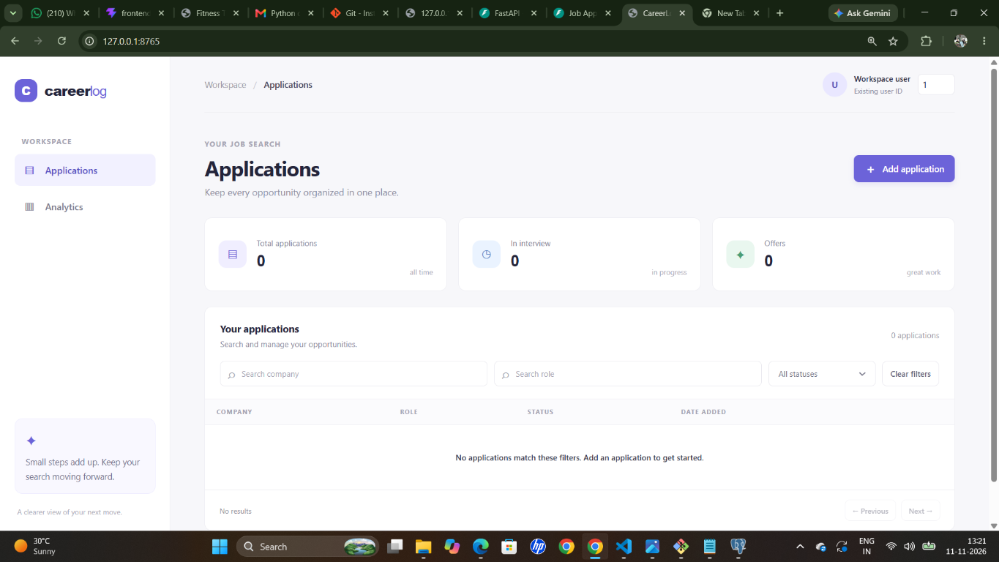
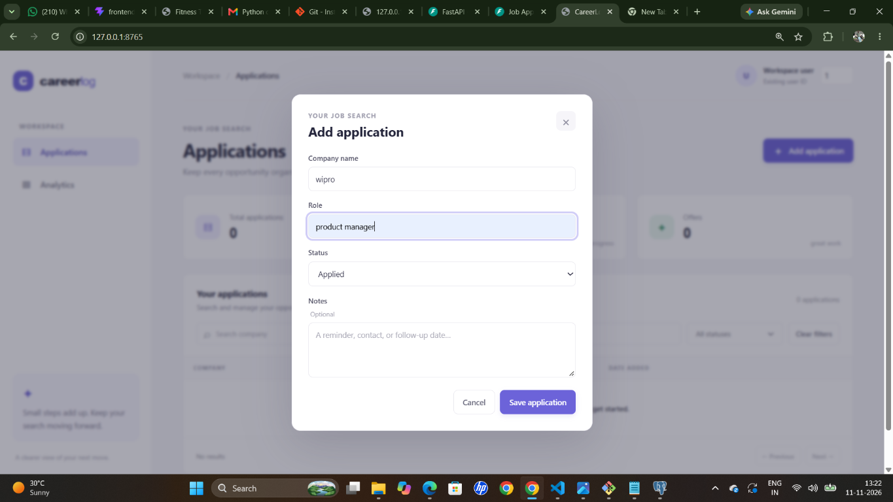
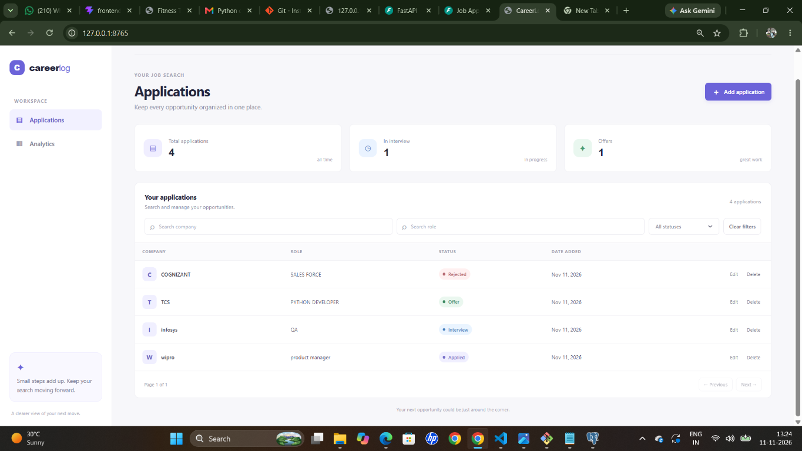
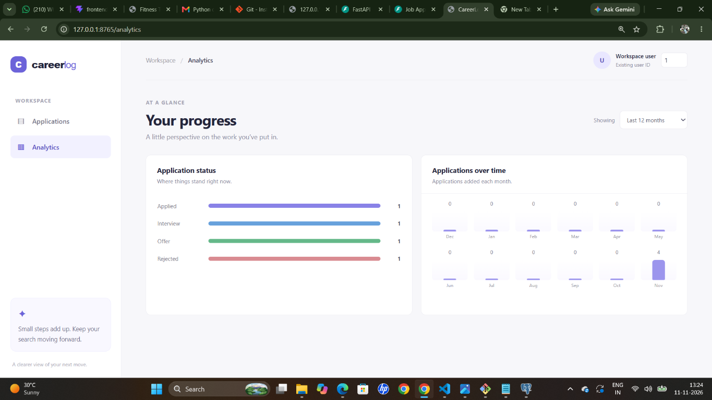

# Job Application Tracker API

A FastAPI and PostgreSQL job application tracker with a dashboard for managing
applications, filtering and paginating results, and viewing status and monthly
analytics.

## Current scope

- CRUD endpoints for job applications.
- User-scoped list, detail, update, delete, and analytics queries.
- Filters by company, role, and status; page size is capped at 100.
- Status distribution includes zero-count statuses. Monthly analytics returns
  the requested number of months, including months with no applications.
- Alembic migration for `users` and `job_applications`, with PostgreSQL
  trigram search indexes for company and role.
- Database and application health endpoints.
- Responsive dashboard with an application form, edit/delete actions, filters,
  server-side pagination, and status/monthly analytics charts.

This project does not currently implement authentication or user registration.
The dashboard's user ID field must refer to an existing row in `users`; it is
for selecting a project data set, not an identity or authorization mechanism.
Create users through a trusted administrative process.

## Project structure

```text
job-application-tracker/
├── app/
│   ├── main.py                 # FastAPI routes and dashboard page routes
│   ├── database.py             # PostgreSQL connection and session setup
│   ├── models.py               # SQLAlchemy users/application models and indexes
│   ├── schemas.py              # Request validation and API response schemas
│   └── static/
│       ├── index.html          # Dashboard and application form markup
│       ├── styles.css          # Responsive dashboard styling
│       └── app.js              # Dashboard interactions and API requests
├── migrations/
│   ├── env.py                  # Alembic database configuration
│   └── versions/               # Versioned database schema migrations
├── tests/
│   └── test_api.py             # API and dashboard tests
├── docs/
│   └── screenshots/            # Demo screenshots embedded below
├── main.py                     # ASGI entry point (main:app)
├── alembic.ini                 # Alembic settings
├── render.yaml                 # Optional Render hosting blueprint
├── requirements.txt            # Python dependencies
└── .env.example                # Local database configuration template
```

## Demo walkthrough

Start the application by following [Setup](#setup), then open the local
dashboard at `http://127.0.0.1:8765/`. The terminal running Uvicorn must remain
open while you use the local demo. The `/analytics` page and `/docs` API
reference use the same local server.

1. **Dashboard:** See the application list, summary cards, and available
   company/role/status filters. The empty state is shown in this screenshot:

   

2. **Add an application:** Click **Add application**, enter a company and role,
   choose one of the four statuses, optionally add notes, and save:

   

3. **Manage applications:** The list shows the saved applications. Use **Edit**
   to update an application or **Delete** to remove one. The example screenshot
   includes applications with different statuses:

   

4. **View analytics:** Click **Analytics** or open
   `http://127.0.0.1:8765/analytics` directly. The status chart counts each
   status, and the time-series chart shows applications added per month:

   

5. **Show the API:** Open `http://127.0.0.1:8765/docs` to explore and try the
   REST API endpoints in Swagger UI.

These are screenshots from a local run with sample records; a fresh database
may initially show the empty dashboard. The localhost URLs only work while the
app server is running on your computer. An online URL is available only after
deploying the project using [Deploy online with Render](#deploy-online-with-render).

## Setup

Use Python 3.11 or newer.

1. Create a PostgreSQL database and copy `.env.example` to `.env`.
2. Set `DB_USER`, `DB_PASSWORD`, `DB_HOST`, `DB_PORT`, and `DB_NAME` for that
   database. An optional `DATABASE_URL` can be used instead.
3. Install dependencies and apply the schema:

   ```powershell
   .\.venv\Scripts\python.exe -m pip install -r requirements.txt
   .\.venv\Scripts\alembic.exe upgrade head
   ```

4. Start the API:

   ```powershell
   .\.venv\Scripts\uvicorn.exe main:app --reload --port 8765
   ```

The dashboard is available at `http://127.0.0.1:8765`, analytics at
`http://127.0.0.1:8765/analytics`, and interactive API documentation at
`http://127.0.0.1:8765/docs`. Choose another free port if 8765 is already in
use. The database user must be allowed to create the `pg_trgm` extension when
applying the initial migration.

To use the default port instead, omit `--port 8765` and open
`http://127.0.0.1:8000` if port 8000 is free.

## Endpoints

| Method | Path | Purpose |
|---|---|---|
| `GET` | `/health` | Application health |
| `GET` | `/health/database` | Database connectivity |
| `POST` | `/applications` | Create an application |
| `GET` | `/applications` | Filter and paginate applications |
| `GET` | `/applications/{id}?user_id=...` | Retrieve one application |
| `PATCH` | `/applications/{id}?user_id=...` | Update supplied fields |
| `DELETE` | `/applications/{id}?user_id=...` | Delete an application |
| `GET` | `/analytics/status?user_id=...` | Counts by status |
| `GET` | `/analytics/time-series?user_id=...&months=12` | Monthly counts |

List query parameters: `user_id` (required), `company`, `role`, `status`,
`page` (default 1), and `page_size` (default 20, maximum 100). Create requests
require an existing `user_id`, `company`, and `role`; `status` defaults to
`Applied`. Valid statuses are `Applied`, `Interview`, `Offer`, and `Rejected`.

## Migrations and tests

```powershell
alembic upgrade head
python -m pytest
```

Tests use an isolated in-memory SQLite database and do not require a running
PostgreSQL server. The trigram indexes and migration are PostgreSQL-specific.
Use `alembic downgrade -1` only when intentionally rolling back the latest
migration; review the migration before doing so on a database with real data.

## Deploy online with Render

The [render.yaml](./render.yaml) Blueprint describes a web service and a
managed PostgreSQL database in the Oregon region. Render's Starter web service
and Basic PostgreSQL plan are paid plans; review current pricing before
deploying. A managed database persists independently of the web service.

1. Push this project to a GitHub repository you control. Do not commit `.env`;
   it is excluded by `.gitignore`.
2. In Render, choose **New → Blueprint**, connect your repository, and apply
   the Blueprint. It creates the web service and database and supplies the
   internal database URL as `DATABASE_URL`.
3. Wait for the first deployment to finish. The start command applies the
   Alembic migration before starting FastAPI. Check the service's `/health`
   endpoint and open the `onrender.com` URL shown in its dashboard.
4. Create a demo user in the Render PostgreSQL database using its dashboard
   connection details:

   ```sql
   INSERT INTO users (name, email, password_hash)
   VALUES ('Demo User', 'demo@example.com', 'demo-only-no-login')
   RETURNING id;
   ```

   Use the returned ID in the dashboard. The placeholder is only for this demo;
   this project does not implement login or password verification.
5. To deploy code changes, push them to the connected branch and let Render
   finish the new deploy. The hosted URL stays the same across deployments.

Do not paste database connection strings or passwords into chat, source files,
or screenshots. Anyone with access to this demo's public URL can use its
unauthenticated API, so use only non-sensitive demo data.
